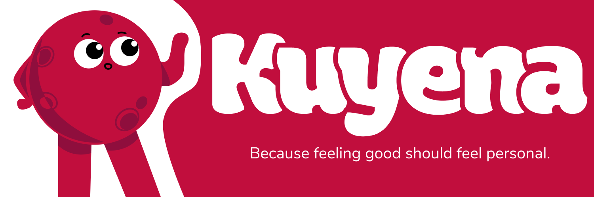
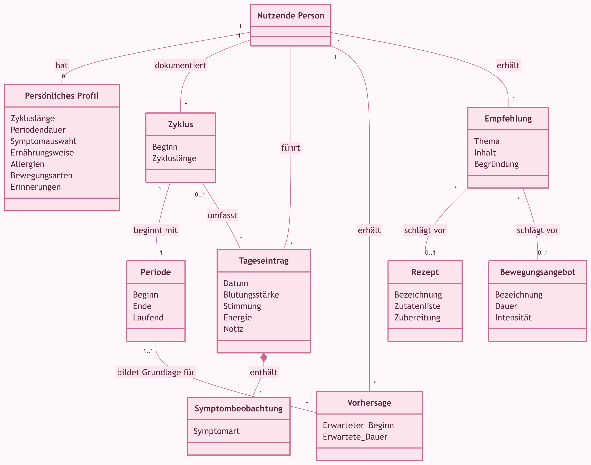
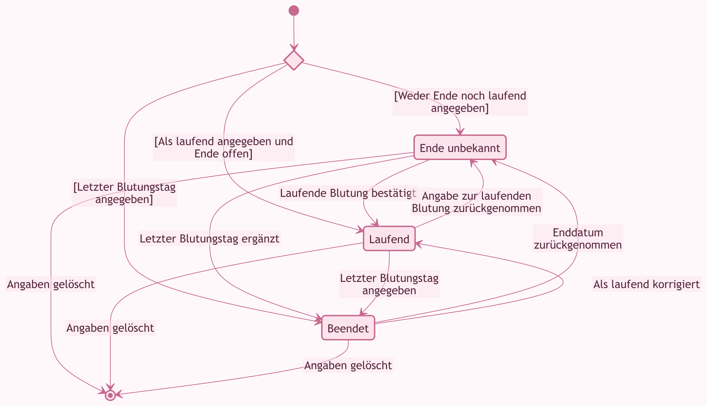

# AD26-Team02



## Team

- Laura Maria Emmerich: lemmeric
- Annouk Preiß: apreiss

<div style="color:#ec407a; text-align:center;">• · ── ✿ ── · • • · ── ✿ ── · • • · ── ✿ ── · • • · ── ✿ ── · • • · ── ✿ ── · • • · ── ✿ ── · •</div>

## Thema

Wir entwickeln einen kostenlosen, quelloffenen und datenschutzorientierten Periodentracker, mit dem Nutzer ihren Menstruationszyklus, Symptome, Stimmung und körperliches Wohlbefinden dokumentieren und auswerten können. Die Anwendung visualisiert vergangene Zyklen, ermöglicht näherungsweise Vorhersagen und bietet individuelle Empfehlungen zu Ernährung, Rezepten und Bewegung, die sich am Zyklus und am persönlichen Wohlbefinden orientieren. Ziel ist es, Menschen dabei zu unterstützen, ihren Körper besser kennenzulernen und selbstbestimmte Entscheidungen über ihre Gesundheit zu treffen, wobei der Schutz sensibler Gesundheitsdaten im Mittelpunkt steht.

<div style="color:#ec407a; text-align:center;">• · ── ✿ ── · • • · ── ✿ ── · • • · ── ✿ ── · • • · ── ✿ ── · • • · ── ✿ ── · • • · ── ✿ ── · •</div>

## Dokumentation

## Aktueller Stand

Wir haben die Grundfunktionen umgesetzt: Perioden und tägliches Wohlbefinden erfassen, Einträge bearbeiten und den Verlauf im Kalender ansehen. Außerdem gibt es erste Zyklusschätzungen, persönliche Einstellungen und eine lokale Datensicherung.

Persönliche Empfehlungen zu Ernährung und Bewegung sowie Erinnerungen bei geschlossener App möchten wir noch ergänzen. Dafür hat die Zeit im Projekt bisher nicht gereicht. Bei den Empfehlungen zeigen wir deshalb zunächst allgemeine Beispielideen.

## Workshop 1: Domain Exploration

<details>
  <summary>Glossar</summary>

| **Geschäftsobjekt** | **Attribut** | **Definition** |
| ------------------- | ------------ | -------------- |
| **Nutzende Person** | | Eine Person, die ihren Zyklus und ihr Befinden dokumentiert und den bisherigen Verlauf betrachtet. |
| **Persönliches Profil** | | Freiwillige Angaben zu den eigenen Gewohnheiten und Vorlieben. |
| | Zykluslänge | Die eigene Einschätzung, wie viele Tage ein Zyklus normalerweise dauert. |
| | Periodendauer | Die eigene Einschätzung, wie viele Tage die Blutung normalerweise dauert. |
| | Symptomauswahl | Symptome, die die Person besonders im Blick behalten möchte. |
| | Ernährungsweise | Die bevorzugte Ernährung, zum Beispiel vegetarisch oder vegan. |
| | Allergien | Von der Person angegebene Lebensmittelallergien. |
| | Bewegungsarten | Aktivitäten, die die Person gerne macht. |
| | Erinnerungen | Ob und wann die Person an Einträge oder die nächste Periode erinnert werden möchte. |
| **Zyklus** | | Der Zeitraum vom ersten Tag einer Periode bis einschließlich des Tages vor Beginn der nächsten Periode. |
| | Beginn | Der erste Tag der zugehörigen Periode. |
| | Zykluslänge | Die Anzahl der Tage zwischen zwei aufeinanderfolgenden Periodenbeginnen. Solange der nächste Beginn fehlt, steht die tatsächliche Länge noch nicht fest. |
| **Periode** | | Eine Menstruationsblutung, die von der Person dokumentiert wird. |
| | Beginn | Der erste Tag der dokumentierten Periode. |
| | Ende | Der letzte Blutungstag. Das Ende kann offenbleiben, wenn es noch nicht bekannt ist. |
| | Laufend | Die Angabe, dass die Blutung noch andauert. Ein fehlendes Enddatum allein bedeutet das nicht. |
| **Tageseintrag** | | Die für einen bestimmten Tag festgehaltenen Angaben zu Blutung und Befinden. Ein Tageseintrag ist auch unabhängig von einer Periode möglich. |
| | Datum | Der Tag, auf den sich die Angaben beziehen. |
| | Blutungsstärke | Die selbst eingeschätzte Stärke einer Blutung an diesem Tag. |
| | Stimmung | Die eigene Einschätzung der emotionalen Verfassung an diesem Tag. |
| | Energie | Die eigene Einschätzung, wie viel Energie die Person an diesem Tag hat. |
| | Notiz | Weitere Beobachtungen, die die Person in eigenen Worten festhält. |
| **Symptombeobachtung** | | Ein Symptom, das die Person an einem bestimmten Tag wahrnimmt und dokumentiert. |
| | Symptomart | Die Bezeichnung des Symptoms, zum Beispiel Kopfschmerzen oder Bauchkrämpfe. |
| **Vorhersage** | | Eine ungefähre Einschätzung, wann eine zukünftige Periode beginnen und wie lange sie dauern könnte. |
| | Erwarteter Beginn | Der geschätzte erste Tag der nächsten Periode. |
| | Erwartete Dauer | Die geschätzte Anzahl der Blutungstage. |
| **Empfehlung** | | Ein Vorschlag zu Ernährung oder Bewegung für den Alltag der Person. |
| | Thema | Der Bereich, auf den sich der Vorschlag bezieht, zum Beispiel Ernährung oder Bewegung. |
| | Inhalt | Der konkrete Vorschlag für die Person. |
| | Begründung | Eine kurze Erklärung, warum der Vorschlag passen könnte. |
| **Rezept** | | Eine Anleitung, wie eine Speise zubereitet wird. |
| | Bezeichnung | Der Name der Speise. |
| | Zutatenliste | Die benötigten Lebensmittel mit Mengenangaben. |
| | Zubereitung | Die einzelnen Schritte zur Zubereitung der Speise. |
| **Bewegungsangebot** | | Eine vorgeschlagene körperliche Aktivität. |
| | Bezeichnung | Der Name der Aktivität. |
| | Dauer | Die vorgesehene Zeit für die Aktivität. |
| | Intensität | Die beschriebene körperliche Anstrengung der Aktivität. |

Nicht ausgefüllte Angaben bleiben unbekannt. Ein leeres Symptomfeld bedeutet zum Beispiel nicht automatisch, dass keine Beschwerden vorlagen.

Persönliche Empfehlungen, Rezepte und ausführlichere Bewegungsangebote gehören zu unserer weiteren Planung. Bisher gibt es dafür allgemeine Beispielideen.

</details>

<details>

  <summary>Datenmodell</summary>

Das Datenmodell zeigt, wie die Begriffe aus unserem Glossar zusammenhängen. Eine Person dokumentiert ihre Zyklen und Tageseinträge. Jeder Zyklus beginnt mit einer Periode. Symptome gehören zu einem Tageseintrag und können auch außerhalb einer Periode auftreten.



Dabei bedeutet `1` genau eins, `*` null bis beliebig viele, `0..1` höchstens eins und `1..*` mindestens eins.

Wir verwenden zwei Beziehungsarten:

- **Assoziation**, die einfache Linie: Die Dinge stehen miteinander in Verbindung.
- **Komposition**, die gefüllte Raute: Eine Symptombeobachtung gehört zu ihrem Tageseintrag. Wird der Tageseintrag gelöscht, werden seine Symptombeobachtungen mit entfernt.

Ein Tageseintrag braucht keinen bekannten Zyklus. Eine Empfehlung kann ein Rezept oder ein Bewegungsangebot vorschlagen. Diese geplanten Inhalte sind im Modell bereits enthalten.

Aggregation und Vererbung brauchen wir für diesen Entwurf zunächst nicht.

</details>

<details>
  <summary>Use-Cases</summary>

Wir verzichten im aktuellen Entwurf auf ein Use-Case-Diagramm. Alle Handlungsfelder sind derselben Rolle „Nutzende Person“ zugeordnet. Weitere Rollen oder externe Systeme sind derzeit nicht vorgesehen. Die Handlungsfelder halten wir deshalb tabellarisch fest. Wenn weitere Rollen dazukommen, prüfen wir die Entscheidung erneut.

| Handlungsfeld | Ziel |
| --- | --- |
| Persönliche Angaben pflegen | Eigene Gewohnheiten und Vorlieben festhalten oder ändern. |
| Tageseintrag pflegen | Symptome, Stimmung, Energie und Notizen für einen Tag dokumentieren oder ändern. |
| Periode dokumentieren | Beginn und Ende festhalten, eine laufende Periode angeben oder frühere Angaben korrigieren. |
| Periodentage korrigieren | Einzelne Tage oder Zeiträume nachtragen oder entfernen. |
| Verlauf betrachten | Bisherige Perioden, Tageseinträge und ungefähre Vorhersagen ansehen. |
| Vorschläge ansehen | Ideen zu Ernährung und Bewegung entdecken. |
| Daten sichern und wiederherstellen | Eine Kopie der eigenen Angaben aufbewahren und bei Bedarf wieder übernehmen. |
| Angaben löschen | Einzelne Einträge oder alle eigenen Angaben entfernen. |

</details>

<details>
  <summary>Prozess</summary>

#### 1. Tageseintrag pflegen

| Feld | Inhalt |
| --- | --- |
| Name | Tageseintrag pflegen |
| Auslösender Akteur | Nutzende Person |
| Weitere Akteure | Keine |
| Auslöser | Die Person möchte Beobachtungen für einen Tag dokumentieren oder ändern. |
| Vorbedingung | Die eigenen Angaben sind zugänglich. Eine Periode oder ein bekannter Zyklus ist nicht erforderlich. |
| Nachbedingung | Der Tageseintrag und seine Symptombeobachtungen sind entsprechend den Angaben gespeichert. |

#### Hauptszenario

| Nr. | Schritt |
| --- | --- |
| 1. | Die Person wählt heute oder einen vergangenen Tag und beginnt einen neuen Tageseintrag. |
| 2. | Das System stellt einen Tageseintrag für diesen Tag bereit. |
| 3. | Die Person erfasst die gewünschten Angaben zu Symptomen, Stimmung, Energie oder weiteren Beobachtungen. |
| 4. | Die Person bestätigt ihre Angaben. |
| 5. | Das System speichert den Tageseintrag mit den zugehörigen Symptombeobachtungen. |
| 6. | Das System zeigt den gespeicherten Tageseintrag an. |

Dabei reicht beispielsweise ein einzelnes Symptom oder eine Notiz. Angaben zur Periode werden getrennt gepflegt und durch diese Bearbeitung nicht verändert.

#### Alternativszenario

| Nr. | Schritt |
| --- | --- |
| 1a. | Die Person möchte einen vorhandenen Tageseintrag ändern. |
| 1a1. | Die Person wählt den vorhandenen Tageseintrag aus. |
| 1a2. | Das System zeigt dessen bisherige Angaben und Symptombeobachtungen an. |
| 1a3. | Weiter mit Schritt 3. Die Änderungen betreffen den ausgewählten Tageseintrag. |
| 5a. | Der neue Tageseintrag enthält noch keine Beobachtung. |
| 5a1. | Das System weist darauf hin, dass mindestens eine Angabe nötig ist. |
| 5a2. | Die Person ergänzt eine Angabe. Weiter mit Schritt 4. |

#### Ausnahmeszenarien

| Nr. | Schritt |
| --- | --- |
| 4a. | Die Person bricht die Bearbeitung ab, statt ihre Angaben zu bestätigen. |
| 4a1. | Die Änderungen werden verworfen. Der Use Case endet ohne Speicherung der Änderungen. |
| 5b. | Das Speichern kann nicht bestätigt werden. |
| 5b1. | Das System informiert die Person darüber. Der Use Case endet ohne bestätigten Erfolg. |
| NB: | Nach einem Speicherfehler muss die Person ihre Angaben erneut prüfen, bevor sie den Eintrag noch einmal erfasst. |

#### 2. Periode dokumentieren

| Feld | Inhalt |
| --- | --- |
| Name | Periode dokumentieren |
| Auslösender Akteur | Nutzende Person |
| Weitere Akteure | Keine |
| Auslöser | Die Person möchte eine Periode dokumentieren oder ihre Angaben korrigieren. |
| Vorbedingung | Die eigenen Angaben sind zugänglich. |
| Nachbedingung | Die Angaben zur Periode sind gespeichert und im Verlauf berücksichtigt. |

#### Hauptszenario

| Nr. | Schritt |
| --- | --- |
| 1. | Die Person beginnt die Dokumentation einer Periode. |
| 2. | Die Person gibt den ersten und den letzten Blutungstag an. |
| 3. | Die Person bestätigt ihre Angaben. |
| 4. | Das System prüft, ob Beginn und Ende spätestens heute liegen und das Ende nicht vor dem Beginn liegt. |
| 5. | Das System speichert die Periode und aktualisiert den angezeigten Verlauf. |
| 6. | Das System zeigt die gespeicherten Angaben an. |

#### Alternativszenario

| Nr. | Schritt |
| --- | --- |
| 1a. | Die Person möchte eine vorhandene Periode korrigieren. |
| 1a1. | Die Person wählt die vorhandene Periode aus. |
| 1a2. | Das System zeigt deren bisherige Angaben an. |
| 1a3. | Weiter mit Schritt 2. Die Änderungen betreffen die ausgewählte Periode. |
| 2a. | Das Ende der Periode ist unbekannt. |
| 2a1. | Die Person gibt den Beginn an und lässt das Ende offen. |
| 2a2. | Weiter mit Schritt 3. Das System prüft nur die vorhandenen Datumsangaben. |
| 2b. | Die Person möchte festhalten, dass die Periode noch läuft. |
| 2b1. | Die Person gibt den Beginn an und bestätigt, dass die Blutung noch andauert. Das Ende bleibt offen. |
| 2b2. | Weiter mit Schritt 3. |
| 2c. | Die Person möchte eine bisher laufende Periode beenden. |
| 2c1. | Die Person gibt den letzten Blutungstag an. Die Periode gilt damit nicht mehr als laufend. |
| 2c2. | Weiter mit Schritt 3. |
| 4a. | Das angegebene Ende liegt vor dem Beginn. |
| 4a1. | Das System weist auf die widersprüchlichen Angaben hin. |
| 4a2. | Die Person korrigiert die Angaben. Weiter mit Schritt 3. |
| 4b. | Beginn oder Ende liegen in der Zukunft. |
| 4b1. | Das System weist darauf hin, dass nur Beobachtungen bis heute dokumentiert werden können. |
| 4b2. | Die Person korrigiert die Angaben. Weiter mit Schritt 3. |

Der letzte Blutungstag zählt zur Periode dazu. Beginn und Ende dürfen auf denselben Tag fallen. Ein unbekanntes Ende allein bestätigt keine laufende Blutung. Einzelne vergessene oder falsch eingetragene Periodentage können nachträglich korrigiert werden, ohne die übrigen Tagesbeobachtungen zu verändern.

#### Ausnahmeszenarien

| Nr. | Schritt |
| --- | --- |
| 3a. | Die Person bricht die Bearbeitung ab, statt ihre Angaben zu bestätigen. |
| 3a1. | Die Änderungen werden verworfen. Der Use Case endet ohne Speicherung der Änderungen. |
| 5a. | Das Speichern kann nicht bestätigt werden. |
| 5a1. | Das System informiert die Person darüber. Der Use Case endet ohne bestätigten Erfolg. |
| NB: | Nach einem Speicherfehler muss die Person die Angaben zur Periode erneut prüfen. |

Ein zusätzliches Flowchart lassen wir zunächst weg, weil die Verzweigungen in den Tabellen überschaubar bleiben.

</details>

<details>

  <summary>Zustände</summary>

Wir verwenden ein Zustandsdiagramm für das Geschäftsobjekt „Periode“. Dabei betrachten wir den Stand der Dokumentation: Die Periode läuft noch, sie ist beendet oder ihr Ende ist unbekannt. Nachträgliche Korrekturen und das Löschen der Angaben werden ebenfalls berücksichtigt.



„Ende unbekannt“ heißt, dass die Person keine sichere Angabe zum Ende oder zum Andauern der Blutung gemacht hat. „Laufend“ heißt dagegen, dass sie die noch andauernde Blutung bestätigt hat. Ein bereits angegebenes Ende kann später korrigiert werden.

Auf separate Zustandsdiagramme für Symptome, Stimmungen oder Zyklusphasen verzichten wir. Für Symptome und Stimmung halten wir einzelne Beobachtungen fest; die Phasen dienen zur Orientierung im Zyklus.

</details>


## Workshop 2: Von der Domäne zum Code

<details>

<summary>Logisches Datenmodell (LDM)</summary>

### 1. Bereinigen und ergänzen

Wir übernehmen nicht jedes Geschäftsobjekt aus unserem fachlichen Datenmodell als eigene gespeicherte Klasse. Die nutzende Person bleibt eine Rolle; ihre persönlichen Angaben werden im `UserProfile` gespeichert.

Zyklen und Vorhersagen werden berechnet und nicht eigenständig gespeichert. Empfehlungen, Rezepte und Bewegungsangebote sind bisher ebenfalls keine eigenständigen Domain-Objekte.

### 2. Attribute bekommen Typen

Wir legen für die tatsächlich gespeicherten Objekte passende Datentypen fest.

| Objekt | Attribut | Datentyp |
|---|---|---|
| `Period` | id | String |
| `Period` | start | CalendarDate |
| `Period` | end | CalendarDate (optional) |
| `Period` | isOngoing | bool |
| `DayEntry` | date | CalendarDate |
| `DayEntry` | flow | FlowIntensity (optional) |
| `DayEntry` | symptoms | Set<Symptom> |
| `DayEntry` | mood | Mood (optional) |
| `DayEntry` | energy | int (optional) |
| `DayEntry` | note | String |
| `UserProfile` | cycleLength | int (optional) |
| `UserProfile` | periodLength | String (optional) |
| `UserProfile` | allergies | Set<String> |
| `UserProfile` | movements | Set<String> |
| `UserProfile` | reminders | bool (optional) |

Eine Periode besitzt eine eindeutige Kennung. Tageseinträge werden über ihr Datum identifiziert. Symptome werden direkt im Tageseintrag gespeichert.

### 3. Berechnete Ansichten

Zykluslängen, Vorhersagen und Zyklusphasen werden aus den vorhandenen Angaben berechnet. Dafür gibt es unter anderem `CycleEstimate`, `PeriodTimeline` und `CyclePhaseOverview`.

Die Berechnungen erzeugen keine zusätzlichen gespeicherten Perioden. Schätzungen bleiben von tatsächlich dokumentierten Beobachtungen getrennt.

</details>

<details>

<summary>Domain Primitives</summary>

### 1. Einsatz von Domain Primitives

Für Kuyena verwenden wir eigene Typen dort, wo fachliche Einschränkungen bestehen. Ein Beispiel dafür ist `CalendarDate`, das einen gültigen Kalendertag ohne Uhrzeit abbildet.

### 2. Weitere fachliche Regeln

| Fachliche Regel | Umsetzung |
|---|---|
| Gültiges Datum | `CalendarDate` |
| Periodenende nicht vor Beginn | `Period` |
| Laufende Periode hat kein bekanntes Ende | `Period` |
| Energie zwischen 0 und 100 | `DayEntry` |
| Feste Auswahlwerte für Symptome und Stimmung | Enums |

Die ursprünglich geplanten Domain Primitives wie `CycleLength` oder `SymptomIntensity` sind im aktuellen Code nicht vorhanden. Deshalb führen wir sie nicht als bereits implementierte Typen auf.

### 3. Beispielhafte Umsetzung in Dart

`CalendarDate` prüft beim Erstellen, ob ein Datum tatsächlich existiert. Auch beim Einlesen wird das erwartete Format kontrolliert.

```dart
factory CalendarDate.parse(String text) {
  if (!RegExp(r'^\d{4}-\d{2}-\d{2}$').hasMatch(text)) {
    throw FormatException('Erwartet wird ein Datum im Format JJJJ-MM-TT.');
  }
  final parts = text.split('-').map(int.parse).toList();
  return CalendarDate(parts[0], parts[1], parts[2]);
}
```

Weitere eigene Typen können sinnvoll sein, wenn zusätzliche fachliche Regeln dazukommen.

</details>

<details>

<summary>Schichtenarchitektur</summary>

### 1. Einsatz der Schichtenarchitektur

Für unsere App verwenden wir eine vereinfachte Schichtenarchitektur. Sie trennt die verschiedenen Aufgabenbereiche und sorgt für eine übersichtliche und wartbare Struktur.

### 2. Die Schichten

| Schicht | Aufgabe | Bestandteile |
|---|---|---|
| **Presentation** | Darstellung der Benutzeroberfläche und Verarbeitung von Eingaben. | Screens, Widgets |
| **Application** | Koordination der Anwendungsabläufe und Use Cases. | Services |
| **Domain** | Fachliche Objekte und Regeln. | Entities, Domain Primitives |
| **Data** | Speichern und Laden der Daten. | Repositories, Speicheradapter |

### 3. Zugriffshierarchie

Die Schichten greifen grundsätzlich auf die darunterliegenden Bereiche zu:

- **Presentation:** Ruft Services auf und stellt Ergebnisse dar.
- **Application:** Steuert die Abläufe und verarbeitet die fachlichen Angaben.
- **Domain:** Enthält die Fachlogik und ist unabhängig von der Benutzeroberfläche.
- **Data:** Übernimmt die technische Speicherung.

Die Trennung ist im aktuellen Code noch nicht überall vollständig umgesetzt. Beispielsweise greifen einige Services direkt auf die Datenschicht zu.

### 4. Beispiel: Tageseintrag pflegen

1. **Presentation:** Die Person gibt Symptome, Stimmung, Energie und Notizen ein.
2. **Application:** Der Service verarbeitet die Eingaben und prüft die Angaben.
3. **Domain:** Fachliche Regeln und Validierungen werden angewendet.
4. **Data:** Der Tageseintrag wird lokal gespeichert.

Die Daten werden über `flutter_secure_storage` gespeichert. Eine SQLite-Datenbank verwenden wir nicht.

</details>

<details>

<summary>Repository</summary>

### 1. Einsatz von Repositories

Repositories kapseln den Zugriff auf gespeicherte Daten. Dadurch muss die Anwendungslogik nicht direkt mit der technischen Speicherung kommunizieren.

Das bringt folgende Vorteile:

- **Wartbarkeit:** Änderungen an der Speicherung betreffen nicht die gesamte Anwendung.
- **Testbarkeit:** Speicherzugriffe können durch Testimplementierungen ersetzt werden.
- **Übersichtlichkeit:** Speicherzugriffe sind zentral organisiert.

### 2. Umsetzung

Für Perioden gibt es eine Repository-Schnittstelle (`PeriodRepository`) und eine lokale Implementierung (`LocalPeriodRepository`).

Das Journal verwendet aktuell `LocalJournalRepository` direkt. Eine eigene Repository-Schnittstelle dafür gibt es noch nicht.

### 3. Speicherung

Die Daten werden lokal als versioniertes JSON-Dokument gespeichert. Dafür verwenden wir `flutter_secure_storage`.

Symptome werden zusammen mit dem jeweiligen Tageseintrag gespeichert und benötigen deshalb kein eigenes Repository. Berechnete Zyklusansichten werden ebenfalls nicht eigenständig gespeichert.

Die Speicherung und Wiederherstellung werden durch zusätzliche Prüfungen und Datenmigrationen abgesichert.

</details>

<details>

<summary>REST</summary>

REST wird verwendet, um über HTTP eine Schnittstelle zwischen verschiedenen Anwendungen oder Systemen bereitzustellen.

Bei uns macht eine REST-Schnittstelle aktuell keinen Sinn, da die Anwendung eigenständig funktioniert und ihre Daten lokal speichert.

Eine Kommunikation mit einem eigenen Server, Benutzerkonten oder eine Synchronisation sind derzeit nicht vorgesehen. Eine spätere Erweiterung müsste gesondert geplant werden.

</details>

<details>

<summary>Packaging</summary>

### 1. Gewählte Struktur

Für Kuyena entscheiden wir uns für eine kombinierte Paketstruktur. Dabei ordnen wir den Code zunächst nach fachlichen Bereichen. Innerhalb dieser Bereiche werden die Aufgaben weiter unterteilt.

Eine vereinfachte Darstellung unserer aktuellen Struktur sieht so aus:

```text
lib/
├── app/
├── calendar/
├── cycle/
├── data/
│   ├── application/
│   ├── backup/
│   └── storage/
├── journal/
│   ├── application/
│   ├── data/
│   ├── domain/
│   └── presentation/
├── periods/
│   ├── application/
│   ├── data/
│   ├── domain/
│   └── presentation/
├── profile/
│   ├── application/
│   ├── domain/
│   └── presentation/
└── recommendations/
    └── presentation/
```

### 2. Begründung

Diese Aufteilung ist für Kuyena sinnvoll, weil fachlich zusammengehörige Funktionen an einem Ort liegen. Dadurch können wir Änderungen leichter zuordnen und behalten den Überblick.

Nicht jedes Modul benötigt alle Schichten. Die Struktur ist bewusst pragmatisch gehalten und kann bei Bedarf erweitert werden.

</details>

## Workshop 3: Quality

<details>

<summary>Teststrategie</summary>

### 1. Ziel der Tests

Wir möchten mit automatisierten Tests sicherstellen, dass die wichtigsten Funktionen von Kuyena zuverlässig arbeiten. Besonders wichtig sind für uns die fachlichen Regeln, Datumsberechnungen und die Speicherung der persönlichen Angaben.

Tests helfen uns außerdem dabei, Änderungen am Code vorzunehmen, ohne bereits funktionierende Funktionen unbeabsichtigt zu beschädigen.

### 2. Testebenen

Für Kuyena verwenden wir verschiedene Testebenen:

- **Unit-Tests:** Einzelne Funktionen und Klassen testen, beispielsweise Datumsvalidierungen und Zyklusberechnungen.
- **Komponententests:** Das Zusammenspiel mehrerer Klassen und Services überprüfen.
- **Speichertests:** Speichern, Laden und Wiederherstellen der Daten prüfen.
- **Widget-Tests:** Bedienabläufe und die Benutzeroberfläche in der Flutter-Testumgebung testen.

Eine SQLite-Integration gibt es nicht, da die App diese Datenbank nicht verwendet. Tests auf echten Android- und iPhone-Geräten sind bisher nicht vollständig nachgewiesen.

### 3. Testpyramide

Wir orientieren uns an der Testpyramide. Das bedeutet, dass wir möglichst viele Unit-Tests und einige Komponententests schreiben. Umfangreichere Tests setzen wir gezielt für wichtige Abläufe ein.

### 4. Wann wir testen

Wir möchten Tests möglichst direkt bei der Entwicklung neuer Funktionen schreiben. Wenn wir einen Fehler finden, sollten wir einen Test erstellen, der diesen nachvollziehbar reproduziert. Anschließend können wir ihn beheben und prüfen, ob der Test erfolgreich ist.

</details>

<details>

<summary>Testfälle finden</summary>

### 1. Vorgehen

Wir können nicht alle möglichen Eingaben testen. Deshalb unterscheiden wir drei Arten von Testfällen:

- **Default-Fälle:** Typische, gültige Eingaben.
- **Edge-Fälle:** Ungewöhnliche, aber gültige Eingaben.
- **Out-of-Bounds-Fälle:** Ungültige Eingaben, die abgelehnt werden müssen.

### 2. Testfälle für Kuyena

Wir leiten unsere Testfälle aus den Use Cases und den fachlichen Regeln ab.

| Testfall | Art | Erwartetes Verhalten |
|---|---|---|
| Tageseintrag ohne Symptome erstellen | Edge | Wird trotzdem gespeichert, wenn eine andere Angabe vorhanden ist. |
| Vollständig leeren Tageseintrag erstellen | Out-of-Bounds | Wird abgelehnt. |
| Energie mit 0 oder 100 angeben | Edge | Wird akzeptiert. |
| Energie unter 0 oder über 100 angeben | Out-of-Bounds | Wird abgelehnt. |
| Periode ohne Enddatum dokumentieren | Edge | Ende bleibt unbekannt. |
| Periode beginnt und endet am selben Tag | Edge | Wird akzeptiert. |
| Periodenende liegt vor dem Beginn | Out-of-Bounds | Wird abgelehnt. |
| Beobachtung für einen zukünftigen Tag speichern | Out-of-Bounds | Wird abgelehnt. |
| Vorhandene Blutungsangaben beim Bearbeiten erhalten | Default | Angaben bleiben bestehen. |

</details>

<details>

<summary>Unit-Tests</summary>

### 1. Ziel der Unit-Tests

Wir testen einzelne Klassen und Funktionen unabhängig voneinander. Besonders unsere Datumswerte, Domain-Objekte und Berechnungen eignen sich dafür, da sie ohne Benutzeroberfläche oder externe Abhängigkeiten geprüft werden können.

### 2. Aufbau der Tests

Wir orientieren uns am Prinzip **Given – When – Then**:

1. **Given:** Ausgangssituation vorbereiten.
2. **When:** Zu testende Aktion ausführen.
3. **Then:** Ergebnis überprüfen.

### 3. Beispiele für Kuyena

| Testfall | Erwartetes Verhalten |
|---|---|
| Gültiges Datum anlegen | Wert wird akzeptiert. |
| Ungültiges Datum anlegen | Fehler wird ausgelöst. |
| Periodenende vor Beginn setzen | Fehler wird ausgelöst. |
| Energie innerhalb der Skala angeben | Wert wird akzeptiert. |
| Energie außerhalb der Skala angeben | Wert wird abgelehnt. |
| Zykluslänge berechnen | Richtiger Tagesabstand wird ermittelt. |

Wir achten darauf, dass unsere Tests schnell, unabhängig voneinander und mit aussagekräftigen Namen geschrieben sind.

</details>

<details>

<summary>Komponententests</summary>

### 1. Ziel der Komponententests

Mit Komponententests prüfen wir das Zusammenspiel mehrerer Klassen. Bei Kuyena betrifft das vor allem unsere Services, Domain-Objekte und die Speicherung.

### 2. Umsetzung

Damit wir unabhängig vom echten Gerätespeicher testen können, verwenden wir einen Speicher im Arbeitsspeicher (`MemoryPeriodStorage`).

So können wir beispielsweise überprüfen, ob Daten nach dem erneuten Aufbau eines Services weiterhin vorhanden sind.

### 3. Mögliche Testfälle

| Testfall | Erwartetes Verhalten |
|---|---|
| Tageseintrag erstellen | Eintrag wird korrekt gespeichert. |
| Periode korrigieren | Kennung und übriger Verlauf bleiben erhalten. |
| Unbekannte Periode bearbeiten | Vorgang wird abgelehnt. |
| Schreibfehler simulieren | Fehler wird gemeldet. |
| Veraltete Daten speichern | Konflikt wird erkannt. |

Ein Testspeicher ersetzt keine Prüfung auf einem echten Gerät. Dafür sind zusätzliche Tests mit dem tatsächlichen Speicher der jeweiligen Plattform notwendig.

</details>

<details>

<summary>Clean Code</summary>

### 1. Ziel

Wir möchten unseren Code so schreiben, dass er für uns beide gut verständlich und leicht änderbar bleibt. Dafür orientieren wir uns an den Grundregeln von Clean Code. Besonders wichtig sind uns sprechende Namen, klare Verantwortlichkeiten und eine einheitliche Struktur.

### 2. Anwendung auf Kuyena

Wir achten bei der Entwicklung auf folgende Regeln:

- **Sprechende Namen:** Wir verwenden eindeutige Begriffe aus unserer Domäne, zum Beispiel `Period`, `DayEntry` und `CalendarDate`.
- **Klare Verantwortlichkeiten:** Perioden, Wohlbefinden, Profil und Speicherung sind in eigenen Bereichen organisiert.
- **Geprüfte Werte:** Fachliche Regeln werden dort geprüft, wo die jeweiligen Objekte und Eingaben verarbeitet werden.
- **Sinnvolle Kommentare:** Kommentare sollen vor allem fachliche Regeln und besondere Entscheidungen erklären.
- **Kein doppelter Code:** Wiederkehrende Logik fassen wir zusammen, sofern sie dieselbe Bedeutung hat.

### 3. Code Smells und Refactoring

Wir achten auf typische Warnzeichen wie lange Methoden, doppelte Logik, unklare Namen und zu viele Verantwortlichkeiten. Wenn wir solche Stellen erkennen, verbessern wir die Struktur durch Refactoring, ohne das Verhalten der Anwendung zu verändern.

Dabei gehen wir schrittweise vor und führen nach Änderungen passende Tests aus.

</details>

<details>

<summary>Statische Code-Analyse</summary>

### 1. Ziel der statischen Code-Analyse

Wir möchten unseren Code nicht nur durch Tests, sondern auch automatisch auf mögliche Qualitätsprobleme prüfen. Eine statische Code-Analyse untersucht den Code, ohne ihn auszuführen.

### 2. Anwendung auf Kuyena

Da wir Kuyena mit Flutter und Dart entwickeln, verwenden wir `flutter analyze` statt PMD, das hauptsächlich für Java eingesetzt wird.

Damit können beispielsweise folgende Probleme erkannt werden:

- Ungenutzte Variablen und Imports
- Mögliche Fehler im Code
- Problematische oder schwer lesbare Konstruktionen
- Verstöße gegen Formatierungs- und Benennungsregeln

Zusätzlich können wir mit `dart format` die Formatierung unseres Codes überprüfen.

### 3. Umgang mit Analyseergebnissen

Wir möchten gemeldete Probleme nicht einfach beheben, ohne sie zu verstehen. Wir prüfen zunächst, ob tatsächlich ein Problem vorliegt, und passen den Code anschließend sinnvoll an.

Die statische Code-Analyse ergänzt unsere Clean-Code-Regeln und Tests. Sie hilft uns, die Qualität und Wartbarkeit von Kuyena langfristig zu verbessern.

</details>

<div style="color:#ec407a; text-align:center;">• · ── ✿ ── · • • · ── ✿ ── · • • · ── ✿ ── · • • · ── ✿ ── · • • · ── ✿ ── · • • · ── ✿ ── · •</div>

## Setup und Start

### Online ausprobieren

Die Browser-Version von Kuyena ist hier erreichbar:

**[Kuyena öffnen](https://kuyena.netlify.app/)**

Zum Ausprobieren empfehlen wir einen aktuellen Chrome-Browser.
Eine Installation ist für die Online-Demo nicht erforderlich.

Die App öffnet zuerst die Handyansicht. Auf großen Bildschirmen
kann über „Desktopansicht“ zur breiten Darstellung gewechselt werden.

**Die Anwendung ist ein Prototyp. Bitte ausschließlich erfundene
Testdaten verwenden.**

### Lokal starten

Voraussetzungen:

- Flutter-SDK installiert und im Terminal verfügbar.
- Google Chrome installiert.
- Repository heruntergeladen oder geklont.

Geprüfte Entwicklungsumgebung: Flutter 3.47.7 mit Dart 3.13.5.
Dart wird mit Flutter mitgeliefert.

Den Projektordner mit der Datei `pubspec.yaml` öffnen.
Anschließend im Terminal dieses Ordners ausführen:

```bash
flutter pub get
flutter run -d chrome --web-port 7357
```

Das Terminal geöffnet lassen, solange die App läuft.
Zum Beenden im Terminal Strg + C drücken.

Bei späteren Starts denselben Port verwenden, damit die lokal
gespeicherten Testdaten weiterhin erreichbar sind.

### Code prüfen

Die statische Analyse und die automatischen Tests werden so gestartet:

```bash
flutter analyze
flutter test
```

### Kurzer Testablauf

1. Die App öffnen und das Onboarding mit erfundenen Angaben durchlaufen.
2. Einen vergangenen Periodenzeitraum mit Beginn und Ende angeben.
3. Auf Home die Zyklusdarstellung ansehen.
4. Über + / Log ein Symptom auswählen und speichern.
5. Im Kalender die Einträge ansehen und Periodentage bearbeiten.
6. Die Seite neu laden und prüfen, ob die Einträge erhalten bleiben.

### Speicherung und aktueller Umfang

Die Einträge werden lokal im jeweiligen Browser gespeichert.
Es gibt keine Synchronisation zwischen Geräten oder Browsern.
Das Löschen von Website-Daten kann auch die Einträge entfernen.

Vorhersagen sind vorläufige Kalenderschätzungen.
Ernährungs- und Bewegungsvorschläge sind bisher allgemeine Beispiele.
Erinnerungen funktionieren derzeit nur bei geöffneter App.

<div style="color:#ec407a; text-align:center;">• · ── ✿ ── · • • · ── ✿ ── · • • · ── ✿ ── · • • · ── ✿ ── · • • · ── ✿ ── · • • · ── ✿ ── · •</div>

## Reflexion

<details>

<summary>Annouk Ida Marie Preiß</summary>

Im Kurs *Application Design* habe ich zusammen mit Laura Maria Emmerich an unserer App **Kuyena** gearbeitet. Die Idee war, einen Zyklustracker zu bauen, weil uns stört, dass viele Apps Geld kosten oder persönliche Daten sammeln. Wir wollten eine App entwickeln, die FLINTA-Personen und damit auch uns hilft, mit dem eigenen Zyklus zu leben. Inzwischen kann man Perioden, Symptome und das Wohlbefinden dokumentieren. Später sollen passende Empfehlungen dazukommen. Dabei habe ich gemerkt, wie viele Entscheidungen hinter einer scheinbar einfachen App stecken.

Am Anfang hatten wir viele Ideen: Kalender, Vorhersagen, Rezepte und Aktivitätenvorschläge. Wir mussten aber erstmal die Grundlagen klären, zum Beispiel wie man Perioden einträgt oder vergessene Tage korrigiert. Dadurch habe ich gelernt, dass Ideenentwicklung auch bedeutet, den Umfang einzugrenzen und Prioritäten zu setzen.

Unsere Entwürfe haben wir zuerst in Figma erstellt und anschließend mit Codex umgesetzt. Dabei wurde deutlich, dass ein fertiges Design noch nicht alle Abläufe erklärt. Fragen wie „Was passiert beim Abbrechen?“ oder „Was bleibt nach dem erneuten Öffnen gespeichert?“ kamen teilweise erst beim Bauen auf. Gestaltung ist dadurch auch die Planung von Funktionen.

KI war ein großer Bestandteil meiner Arbeit. Ich habe Codex genutzt, um Kursinhalte zu verstehen, Modelle und Dokumentation zu erarbeiten und die App zu programmieren. Die KI hat größere Teile des Codes erstellt, verändert und Tests ausgeführt. Besonders hilfreich war, mir Kursinhalte anhand unserer App erklären zu lassen. Das Raumschiffthema aus den Kursbeispielen war mir ehrlich gesagt zu abstrakt. Durch Kuyena konnte ich die Zusammenhänge besser verstehen.

Mit KI konnte schnell viel entstehen, während mein Verständnis langsamer gewachsen ist. Deshalb musste ich nachfragen und mir die Umsetzung erklären lassen. Außerdem habe ich gemerkt, wie präzise ich meine Erwartungen formulieren muss. Sonst trifft die KI eigene Annahmen und baut etwas, das anders funktioniert als gedacht. Ein Beispiel war die Trennung von Periodeneingaben und Wohlbefinden. Ich musste immer wieder nachhaken und selbst Entscheidungen treffen.

Maria und ich haben die Verantwortungen in Design und Programmierung aufgeteilt. Wir haben gut kommuniziert und unsere Perspektiven eingebracht. Trotzdem hätten wir uns früher aktiver zusammensetzen sollen, weil wir zum Schluss mit der Abgabe etwas in Zeitstress gekommen sind.

Der Kurs hat mir geholfen, Softwareprojekte strukturierter zu betrachten. Wie gesagt Glossar, Use Cases, Datenmodell und Schichtenarchitektur wurden am eigenen Projekt verständlicher. Zum Beispiel macht es einen Unterschied, ob ein Periodenende unbekannt ist oder die Periode ausdrücklich noch läuft. Auch eingetragene Beobachtungen und Schätzungen müssen unterschieden werden. Teilweise war unsere Umsetzung schon weiter als die Dokumentation. Rückblickend hätte ich Regeln früher festhalten und Änderungen regelmäßiger dokumentieren sollen. Mehr Zeit zum Nachvollziehen der technischen Schritte hätte mir geholfen.

Ich nehme mit, dass KI ein hilfreiches Tool ist, ich aber verstehen muss, was sie tut, und Verantwortung für das Ergebnis trage. Für zukünftige Projekte möchte ich in kleineren Schritten arbeiten und Änderungen bewusster nachvollziehen. Mit Kuyena bin ich bisher zufrieden. Es gibt noch viel zu verbessern, aber darauf freue ich mich und hoffe, dass die App später vielen FLINTA-Personen hilft.

</details>

<details>

<summary>Laura Maria Emmerich</summary>

Wenn ich auf die letzten drei Wochen zurückblicke, würde ich sagen, dass wir mit sehr viel Enthusiasmus, aber vielleicht auch ein bisschen zu voreilig an unser Projekt herangegangen sind.

Eigentlich hatten wir schon am ersten Tag die Idee, eine Periodentracker-App zu entwickeln. Als unser Professor dann meinte, dass wir die Werkzeuge aus dem Kurs auch auf ein eigenes Projekt anwenden dürfen, waren wir direkt begeistert. Wir selbst waren schon länger frustriert davon, dass viele Perioden-Apps wichtige Funktionen nur in kostenpflichtigen Premium-Versionen anbieten und persönliche Daten für kommerzielle Zwecke weitergeben. Auch gestalterisch hatten wir einige Vorstellungen davon, wie eine solche App aussehen könnte. Wir wollten es einfach besser machen und hatten direkt große Lust, unsere eigene Idee umzusetzen.

Rückblickend würde ich allerdings sagen, dass wir uns dadurch manchmal etwas zu sehr auf die Entwicklung der App konzentriert und die eigentlichen Aufgaben des Kurses aus den Augen verloren haben. Wir waren vermutlich wie viele andere, die voller Motivation eine eigene App bauen möchten: Wir wollten am liebsten direkt alles umsetzen. Zum Glück hatte ich durch ähnliche Projekte schon ein wenig Erfahrung gesammelt und deshalb vorgeschlagen, zunächst mit einem MVP zu arbeiten. Also erst einmal die wichtigsten Funktionen umzusetzen, statt direkt eine riesige App zu planen. Dabei zu bleiben, hat sich allerdings als eine der größten Herausforderungen herausgestellt.

Ein Bekannter, mit dem ich bereits an einem anderen App-Projekt gearbeitet habe, hat einmal zu mir gesagt: „Jedes Mal, wenn man sich wieder an ein Projekt setzt, sollte man nicht überlegen, was man noch hinzufügen kann, sondern was man entfernen kann.“ Diesen Gedanken fand ich rückblickend ziemlich passend. Denn gerade bei einer Idee, für die man selbst so viel Begeisterung mitbringt, fällt es schwer, Funktionen wieder wegzulassen oder auf später zu verschieben.

Außerdem haben wir viele Aufgaben irgendwie in die Modulwoche geschoben, wodurch teilweise ziemlicher Zeitdruck und Stress entstanden sind. Hier hätten wir unsere Zeit wahrscheinlich besser einteilen und die Kursaufgaben kontinuierlicher bearbeiten können.

Trotzdem fand ich die Werkzeuge und Methoden aus dem Kurs im Nachhinein wirklich hilfreich. Natürlich würde ich nicht unbedingt jedes einzelne davon in einem zukünftigen Projekt verwenden. Manche Dinge haben wir eher der Vollständigkeit halber bearbeitet. Andere waren dafür umso hilfreicher, um unser Projekt besser zu verstehen, zu strukturieren und mögliche Probleme frühzeitig zu erkennen. Besonders gut fand ich, dass wir die theoretischen Inhalte direkt auf ein eigenes Projekt beziehen konnten und dadurch besser verstanden haben, wofür die einzelnen Methoden überhaupt nützlich sind.

Auch die Zusammenarbeit in unserem Zweierteam hat für mich gut funktioniert. Annouk hat sich hauptsächlich mit der Programmierung beschäftigt, während ich mich vor allem um das Design und die allgemeine Aufbereitung des Projekts gekümmert habe. Diese Aufteilung hat mir persönlich auch sehr viel Spaß gemacht.

Alles in allem nehme ich aus den letzten drei Wochen einiges mit. Vor allem, dass man sich bei einem eigenen Projekt manchmal bewusst bremsen muss, um den Überblick nicht zu verlieren. Gleichzeitig hat mir der Kurs gezeigt, dass viele der vorgestellten Werkzeuge auch über die eigentlichen Kursaufgaben hinaus einen echten Mehrwert haben können.

Ich freue mich auf jeden Fall sehr darauf, Kuyena weiterzuentwickeln und aus unserer bisherigen Idee Schritt für Schritt eine richtige App zu machen. Unser langfristiges Ziel ist es, das Projekt als Open-Source-Anwendung zu veröffentlichen. Und darauf freue ich mich wirklich sehr!

</details>

<div style="color:#ec407a; text-align:center;">• · ── ✿ ── · • • · ── ✿ ── · • • · ── ✿ ── · • • · ── ✿ ── · • • · ── ✿ ── · • • · ── ✿ ── · •</div>