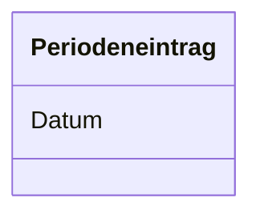
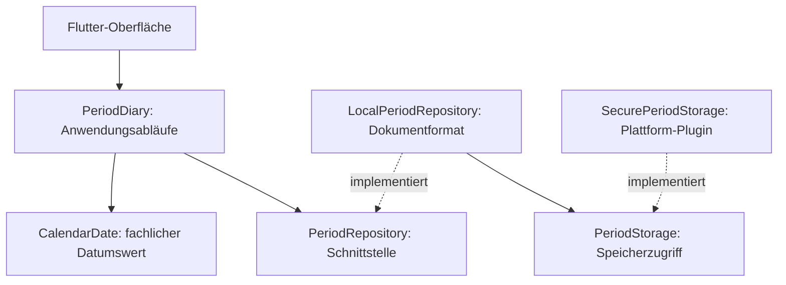

# Erster Meilenstein: Periodenbeginn dokumentieren

Stand: 18.10.2026. Zielplattformen: Android, iPhone und Browser.
Dieses Dokument begleitet die erste Implementierung; weiterführende Funktionen
aus der Produktidee bleiben zunächst außerhalb dieses Meilensteins.

Historischer Stand des ersten Meilensteins. Seit 26.10.2026 können Perioden
auch mit optionalem Ende erfasst werden; siehe [aktuelles Periodenmodell](periodenmodell.md).

## Glossar

| Begriff | Definition |
| --- | --- |
| Periodenbeginn | Ein ausdrücklich von der nutzenden Person als Beginn einer Periode dokumentierter Kalendertag. Nicht automatisch jeder Tag mit Blutung. |
| Periodeneintrag | Ein dokumentierter Periodenbeginn. Im ersten Modell ist das Datum seine natürliche Kennung. Pro Tag besteht höchstens ein Eintrag. |
| Verlauf | Alle dokumentierten Periodenbeginne, mit dem jüngsten Datum zuerst. Fehlende Einträge werden nicht als ausgebliebene Periode interpretiert. |
| Korrektur | Ändern des Datums eines bestehenden Eintrags. Die anderen Einträge bleiben erhalten. |

## Fachliches Modell

Ein lokaler Verlauf enthält beliebig viele Einträge. Ein eigenes Konto wird
nicht modelliert, da die App keine Nutzerkonten verwaltet.
Zyklusphasen und Vorhersagen sind noch nicht Teil dieses Modells.

## Logisches Modell und Regeln

- `CalendarDate` ist ein unveränderlicher Wert für einen echten Kalendertag.
- Speicherung als `JJJJ-MM-TT`; Anzeige als `TT.MM.JJJJ`.
- Keine Speicherung als UTC-Zeitpunkt: Eine Zeitzonenänderung soll aus
  einem beobachteten Tag keinen anderen Tag machen.
- Ein Periodenbeginn darf beim Erfassen/Korrigieren nicht in der Zukunft liegen.
- Dasselbe Datum darf nur einmal vorkommen. Ein belegtes Korrekturziel wird abgelehnt.
- Es gibt keine vorgeschriebene Mindestlänge zwischen zwei Periodenbeginnen.
- Beschädigte Daten oder eine unbekannte Speicherversion werden beim Laden
  gemeldet und nicht automatisch durch leere Daten ersetzt.

## Use Cases und Szenarien

Ein Akteur: die Person, die ihren eigenen Verlauf dokumentiert.
Use Cases: Periodenbeginn erfassen, Verlauf ansehen, Eintrag korrigieren,
Eintrag löschen, alle Periodeneinträge löschen.

### Periodenbeginn erfassen

**Vorbedingung:** Der bestehende Verlauf wurde erfolgreich geladen.
**Auslöser:** Die Person wählt „Periode eintragen“.
**Nachbedingung bei Erfolg:** Der neue Eintrag ist lokal gespeichert;
vorhandene Einträge bleiben erhalten.

1. Die Person wählt einen Kalendertag und bestätigt die Auswahl.
2. Die Anwendung lädt den aktuellen Verlauf und prüft Datum und Eindeutigkeit.
3. Die Anwendung speichert den ergänzten Verlauf und liest den Wert zur Bestätigung zurück.
4. Erst nach bestätigtem Speichern zeigt sie den neuen Verlauf und eine Erfolgsmeldung.

**Alternative:** Die Person bricht die Datumsauswahl ab; der Verlauf bleibt unverändert.
**Ausnahme:** Doppeltes/künftiges Datum oder Speicherfehler: verständliche Fehlermeldung,
keine neue Erfolgsmeldung. Bei einem unklaren Speicherausgang wird erneutes Laden angeboten.

### Korrigieren und Löschen

- Korrigieren ersetzt ausschließlich das ausgewählte Datum nach den obigen Regeln.
- Löschen erfordert eine Bestätigung. Abbrechen ändert nichts.
- Der letzte Eintrag bzw. „Alle Einträge löschen“ entfernt das gesamte Periodendokument.
- Fehlgeschlagene Änderungen werden nicht als erfolgreich dargestellt.
- Nach einem Lesefehler ist Erfassen/Korrigieren gesperrt. Erneutes Laden oder
  ausdrücklich bestätigtes Löschen aller Periodeneinträge erlaubt die Wiederaufnahme.

## Architektur und Packaging

Die Dateien liegen fachlich unter `lib/periods/`, innen aufgeteilt in
`domain`, `application`, `data` und `presentation`. Der Service bekommt das
Repository von außen. Die Oberfläche entscheidet weder über Dateiformate
noch über die fachliche Zulässigkeit einer Korrektur.

## Designentscheidungen

| Entscheidung | Grund und Folge |
| --- | --- |
| Ein gemeinsames Flutter-Projekt | Dieselben fachlichen Regeln und Oberflächen für mobile App und Browser. |
| Kleine versionierte Datensammlung hinter einem Repository | Für diesen Meilenstein ausreichend; bei deutlich mehr Symptomdaten erneut bewerten. |
| Plattform-Speicherschutz statt eigener Kryptografie | Nutzung von `flutter_secure_storage`. Die experimentelle Web-Implementierung ist ein ausdrücklich gekennzeichneter Prototyp für Testdaten. |
| Keine Synchronisation | Kein Backend für Gesundheitsdaten; Geräte und Browser haben getrennte Datenbestände. |
| Keine REST-Schnittstelle | Der lokale Ablauf benötigt keine Serveranfragen. |
| Kein Zustandsdiagramm für Zyklusphasen | Es werden Beobachtungen dokumentiert, keine biologischen Phasen als verbindlicher Automatenablauf modelliert. |
| Keine Vorhersagen oder Empfehlungen in diesem Schritt | Erst den verlässlichen Dokumentationsablauf bauen und prüfen. |

## Prüfungen

Automatisiert: Datumsformate, Schaltjahre, heutige/künftige und doppelte
Tage, Historienerhalt bei Korrektur/Löschen, Speicherfehler, beschädigte
Dokumente, Neuaufbau aus demselben Test-Speicher und eine kleine Handyansicht.
Der Test-Speicher ersetzt keine Prüfung des tatsächlichen Plattform-Plugins.

### Ausgeführte Prüfungen am 18.10.2026

- `flutter analyze --no-pub`: keine Probleme.
- `flutter test --no-pub`: alle 25 Tests bestanden.
- `flutter build web --no-pub --no-web-resources-cdn`: erfolgreich.
- Echter Browser auf einer getrennten lokalen Origin mit ausschließlich
  synthetischen Testdaten: Einträge nach Neuladen erhalten; Korrektur behält
  den anderen Eintrag; Löschabbruch erhält Daten; bestätigtes Löschen bleibt
  nach Neuladen wirksam; nach dem Zurücksetzen und erneutem Öffnen ist der
  Verlauf leer. Die vorhandenen Daten der separaten sichtbaren Vorschau
  wurden dabei nicht verändert.
- Native Android-/iOS-Prüfung nicht ausgeführt: Android SDK und vollständiges
  Xcode sind auf diesem Rechner noch nicht eingerichtet.

### Checkliste für weitere Zielplattformen

Mit Testdaten auf jeder Zielplattform prüfen:

1. Zwei verschiedene Periodenbeginne erfassen.
2. App vollständig schließen/Browserseite neu laden; beide Einträge müssen erhalten bleiben.
3. Einen Eintrag korrigieren, erneut öffnen und den Erhalt des anderen kontrollieren.
4. Löschen zuerst abbrechen, dann bestätigen; erneut öffnen und Ergebnis kontrollieren.
5. Alle Einträge löschen; nach erneutem Öffnen muss der Verlauf leer sein.

Noch offen: reale Android-/iOS-Gerätetests, unabhängige Sicherheitsprüfung,
Export/Wiederherstellung und Koordination mehrerer gleichzeitig bearbeitender Tabs.
Der bisherige `main.dart`-Prototyp hatte nur einen flüchtigen Datumswert;
es gibt daher keine gespeicherten Altbestände zu migrieren.

## KI-Nutzung

18.10.2026: Codex hat das vorhandene Flutter-Projekt untersucht, die Plattform-
Dokumentation recherchiert und diesen ersten Meilenstein einschließlich
Modell, Implementierung und Tests umgesetzt und die oben dokumentierten Prüfungen ausgeführt. Die fachlichen Annahmen und
der fertige Code sollen im Team nachvollzogen und geprüft werden.
Die persönliche Reflexion wird von jedem Teammitglied selbst verfasst.
